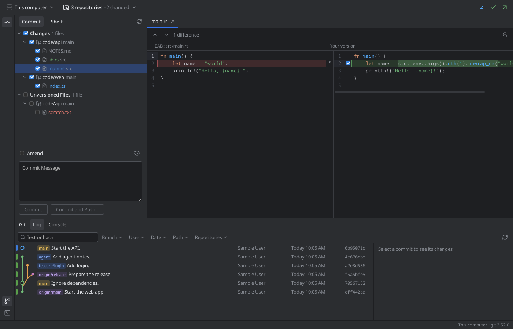

# GitSense

A lightweight desktop Git client for managing all your git repos, either locally or over SSH. GitSense is based on IntelliJ IDEA's built-in Git tools, without the extra weight of installing a multi-GB IDE on every machine and waiting for a bunch of extra functionality.

> **Early development:** expect missing features and bugs. Linux x86_64 only.



## Building

You need:

- [Rust](https://rustup.rs) (stable) with the musl target: `rustup target add x86_64-unknown-linux-musl`
- [Node.js](https://nodejs.org) 22 or newer and [pnpm](https://pnpm.io)
- Tauri's system libraries. On Debian, Ubuntu, or Mint:

  ```sh
  sudo apt install libwebkit2gtk-4.1-dev build-essential curl wget file libxdo-dev libssl-dev libayatana-appindicator3-dev librsvg2-dev
  ```

  Other distros: see [Tauri's prerequisites](https://v2.tauri.app/start/prerequisites/#linux).

Then build:

```sh
git clone https://github.com/Lightning11wins/GitSense.git
cd GitSense/app
pnpm install
pnpm build
```

This produces a `.deb` and an AppImage in `target/release/bundle/`.

## Using it

Launch GitSense and pick **This computer** or a host from your `~/.ssh/config`. GitSense automatically detects repos in that machine's home directory.

Remote machines need only `sh`, coreutils, and git 2.34 or newer. On the remote machine, GitSense uses your system `ssh`; so your SSH config, keys, and agent work as usual. On first connect, it uploads a small helper program (about 1.3 MB) to `~/.cache/gitsense/`, creating a remote GitSense server.

## Development

From `app/`:

```sh
pnpm dev     # run the app with live reload
pnpm test    # UI tests
cargo test   # helper and protocol tests
```

[DESIGN.md](DESIGN.md) covers the architecture and planned features.
